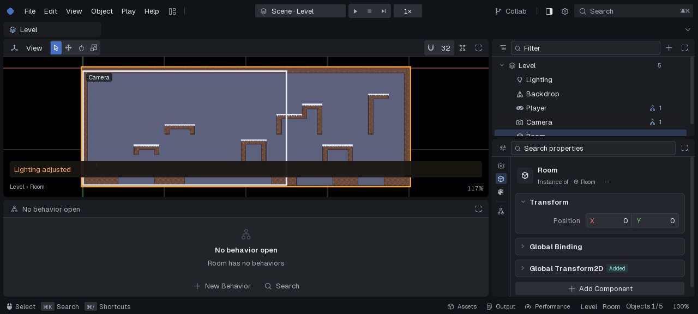
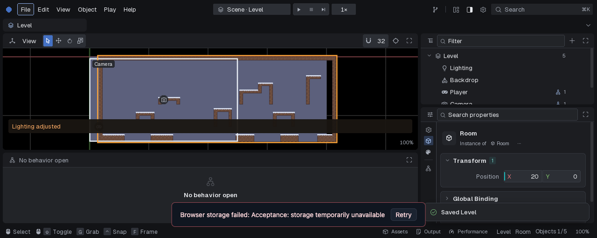

# Serial browser acceptance, 2026-10-10

The published Celeste player and its embedded editor were exercised through
trusted browser pointer and physical-key events in an isolated browser profile.
The checks found a save/reload data-loss window. The candidate storage fix passed
the same reload case and a storage-failure recovery case in a rebuilt web editor.

## Published versions

The [Celeste build manifest](https://waldnercharles.github.io/chibi-celeste/build.json)
and [project manifest](https://waldnercharles.github.io/chibi-celeste/dev/project.json)
identified the following versions when inspected:

| Component | Revision |
| --- | --- |
| Game | `65a777b2171af465f4124dccc8e931b6cd944ee1` |
| Engine | `aa674723b93a27bd13b672c7ae8f84127a698031` |
| Studio | `28655e2ed98ee2d3b6ad53e252f463a220f77e4c` |
| Project ZIP SHA-256 | `f940e10afcccceacd681122a327f9c587cb94b4f5160a1f09f0ff18b9b81e6fa` |

The published checks used HeadlessChrome 154 on macOS with an initialized WebGPU
device. The adapter identity was not captured. Rendering was paused between
bounded interaction batches.

## Published results

| User action | Observed result |
| --- | --- |
| Open the player; hold D, press Space, press X | The player moved, jumped and dashed, with the dash hair-color change visible. |
| Open `?dev` | Redirected to `/dev/`; opened Celeste's Level with Lighting, Backdrop, Player, Camera and Room. |
| File > Export Project; File > Import Project | Downloaded a ZIP and opened an independent workspace with a `-2` suffix. |
| Scrub Room X from 0 to 10; File > Save; reload | Reloaded Room X = 10. |
| Edit Room X to 20; Cmd+S; export | Downloaded ZIP contained Room X = 20; all 14 entries passed CRC checks. Original published workspace remained unchanged. |
| Revisit the same published revision | Retained the workspace's edits. |
| Open another revision; return to the first | New revision used the original project; the first retained its edits. |

Revision isolation used two controlled, same-origin manifest responses with an
explicit fixture ID and revisions of forty `a` and forty `b` characters. Both
referenced the genuine published archive and checksum. Revision A retained Room
X = 15 after reload; revision B had the original Room position; opening A through
`?project=` restored 15. This checks workspace selection across revisions, not a
second production deployment.

## Save/reload regression and candidate

On the published editor, save Room X = 10 and let it persist. Then scrub X to 20,
choose File > Save, and reload on the first animation frame where
`Module.chibiUnsaved` becomes zero. The file in memory contains 20, but the browser
does not protect `beforeunload`; reloading restores the older persisted value 10.
The 250 ms storage debounce outlives the document's dirty state.

The candidate sets a separate pending-storage flag before that debounce,
serializes project flushes, and retains the flag until all saves made during a
flush have reached IndexedDB. The shell shows saving progress and an actionable
Retry after a failed flush. Document dirty state remains independent.

Candidate verification used Chrome 155 on macOS, Studio base
`d10222dc73e01340dd3ccd193ab016c706708ffc` plus this change, and the published
engine web SDK `fd69f0bf953e1adfa40bcc053162747db95d12ff`. SDK checksums were
verified, Emscripten 6.0.10 matched its build metadata, and the rebuilt serial
editor ran from a local server with the genuine Celeste source ZIP.

- Repeat the immediate-reload trigger after a real pointer edit and File > Save.
  Chrome opens a `beforeunload` dialog while `chibiStoragePending` is true and the
  shell says “Saving project...”. Dismissing that dialog with “Stay” allows the
  flush to finish. A subsequent real reload retains Room X = 10.
- Make a real pointer edit to Room X = 20 and inject one asynchronous error from
  `FS.syncfs(false)`. The document is clean, but storage remains pending and the
  shell displays the error with Retry. Click that visible button using trusted
  pointer events. The status clears, and a real reload retains Room X = 20.
- Choose File > Import Project with the published ZIP and inject one failed
  storage flush. The editor stays on the current project and preserves Retry.
  Click Retry, then reload: the imported scene's bytes match the ZIP exactly.

The engine's existing C/pico `--web-storage` dispatcher also runs the actual
storage script and shell with a controlled filesystem. Five new regression cases
cover the pending debounce, a newer save during a held flush, failed-save Retry,
and failed new-project and import flushes whose error handlers must preserve
Retry. All five fail against the original scripts. Run this selector with
`CHIBI_STUDIO_SOURCE` pointing to this Studio checkout.

These results cover the serial browser path and the specific interactions above.
They do not establish worker-mode, cross-browser, full native GPU or full Studio
suite coverage. No deployment was changed. A user who accepts the browser's
leave warning can still discard data that has not reached storage.
